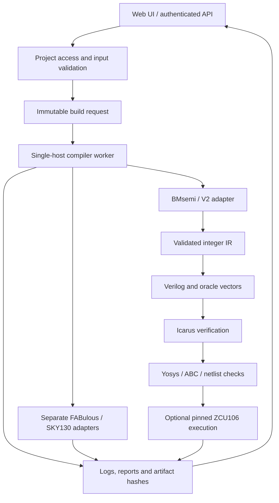

# BM Labs AI Compiler Platform

A Django web platform for traceable AI-model compilation, RTL verification, FABulous fabric configuration and controlled FPGA execution.

The platform connects existing BM Labs compiler and hardware repositories through bounded subprocess adapters. It records the commands that actually ran, their tool versions, standard output, standard error, exit codes, execution times and generated artifacts. Missing tools, unsupported inputs and failed checks remain visible as failures or blocked operations.

**Current scope:** a supported single-layer Linear model can be captured into IR, quantized, emitted as Verilog, verified and synthesized. Separately configured workflows exercise candidate X2 RTL, a FABulous reference fabric, a pinned ZCU106 overlay and the upstream SKY130 ReRAM counter. **The proposed A1–A4 AI agents are an architecture roadmap, not an implemented autonomous agent service.**

## Contents

- [Capabilities and limits](#capabilities-and-limits)
- [Architecture](#architecture)
- [Quick start](#quick-start)
- [Supported model format](#supported-model-format)
- [Compiler setup and execution](#compiler-setup-and-execution)
- [Hardware targets](#hardware-targets)
- [AI-agent architecture](#ai-agent-architecture)
- [API and artifacts](#api-and-artifacts)
- [Testing](#testing)
- [Deployment](#deployment)
- [Repository layout](#repository-layout)
- [Publication and licensing](#publication-and-licensing)

## Capabilities and limits

| Pipeline | What actually executes | Boundary |
| --- | --- | --- |
| `linear-int8-v1` | Existing BM/V2 passes, IR validation, Verilog generation, numerical RTL verification and logical PE checks | One bounded Linear layer; logical mapping does not establish physical placement |
| `linear-synth-v1` | Linear workflow plus Yosys synthesis, ABC equivalence and netlist simulation | Does not create a physical-target bitstream |
| `linear-fpga-v1` | Compile/verify the model, program a pinned ZCU106 Qwen6 overlay and compare real MVM results with independent vectors | Administrator-only; PL performs MVM, processor performs bias/ReLU; generated FABulous configuration is not loaded |
| `zcu106-preflight-v1` | Read-only board identity, runtime and pinned asset checks | No programming or numerical computation test |
| `x2-candidate-v1` | Source-pinned behavioral X2 regression with reviewable fixes on a private source copy | Candidate behavior, not a finalized ASIC ABI |
| `fabulous-reference-v1` | Upstream reference-counter synthesis, routing, bitstream generation and configured-fabric simulation | Reference fabric, without BM ASIC or board binding |
| `sky130-counter-v1` | Pinned SKY130 counter synthesis, nextpnr/FASM, binary generation, hex export and framing validation | Compile-only; does not consume the project's Python model or program a board |

Experimental model-specific FABulous postprocessing and AXI configuration-shell modules are development code, not an enabled public pipeline. Their host-specific fabric bundle and physical deployment configuration are excluded from this repository.

The application also provides email accounts, verification/reset flows, organization roles, personal/shared projects, private uploads/downloads, immutable build snapshots, audit events, target metadata and session-authenticated REST APIs.

### Explicit limits

- Arbitrary uploaded Python, general PyTorch models and general ONNX compilation are unsupported.
- The complete 51-node TinyMobileNet graph is not an implemented end-to-end hardware pipeline.
- Wishbone X2, the ZCU106 overlay and SKY130 ReRAM do not share a finalized universal ABI.
- SKY130 physical loading, timing signoff and numerical ReRAM verification remain outstanding.
- Exit-zero synthesis/routing is not sufficient evidence of timing closure or hardware correctness.
- The system is not a production multi-tenant compiler sandbox or a security certification.
- No A1–A4 LLM service is integrated. `AI_MODEL_ENDPOINT` is reserved configuration, not an active model-provider backend.

## Architecture



Django owns identity, authorization, records and artifact access. The dedicated worker claims queued jobs and executes administrator-selected adapters. Existing repositories are imported or copied for bounded operations rather than rewritten. Uploaded model files are parsed as data.

The queue uses database records and an exclusive worker lock. It is **not a distributed Celery compiler queue**. See [architecture](docs/architecture.md).

## Quick start

The web application supports Python 3.12. Compiler tools and upstream model runtimes are separate dependencies.

### Windows / PowerShell

```powershell
python -m venv .venv
.\.venv\Scripts\python.exe -m pip install -r requirements.lock.txt
Copy-Item .env.example .env
.\.venv\Scripts\python.exe manage.py migrate
.\.venv\Scripts\python.exe manage.py seed_reference
.\.venv\Scripts\python.exe manage.py createsuperuser
.\.venv\Scripts\python.exe manage.py runserver 127.0.0.1:8765
```

### Linux / macOS: web application

```bash
python3.12 -m venv .venv
. .venv/bin/activate
python -m pip install -r requirements.lock.txt
cp .env.example .env
python manage.py migrate
python manage.py seed_reference
python manage.py createsuperuser
python manage.py runserver 127.0.0.1:8765
```

Open <http://127.0.0.1:8765>. There are no default shared credentials. Development verification/reset emails appear in the console; production requires SMTP. Development uses SQLite and creates an ignored `.local-secret` when needed.

`seed_reference` installs reference metadata only. It does not attach hardware or validate a physical target. Compiler execution is disabled by default. The hardware adapters were exercised primarily on Windows with native tools and WSL; web portability does not imply every board/tool adapter is configured on Linux/macOS.

## Supported model format

Upload `model.py` containing one literal assignment:

```python
MODEL = {
    'schema': 'bmlabs.linear-int8.v1',
    'weights': [[1, -2, 3, 0], [-4, 1, 0, 2],
                [2, 2, -1, 1], [0, -3, 1, 4]],
    'bias': [3, -7, 0, 11],
    'relu': True,
}
```

See [the input example](examples/linear_int8/model.py).

| Property | Contract |
| --- | --- |
| Dimensions | 1–32 input features and 1–32 output features |
| Weight layout | `[output][input]` |
| Source weights | Finite integers/floats in `[-127, 127]`; quantized by the V2 adapter |
| Inputs | Signed int8 |
| Lowered weights | Quantized integers; scale/error evidence retained |
| Bias | One integer per output in accumulator units, magnitude at most `2^20` |
| Outputs | Signed int32 accumulator, optional ReLU |
| Input size | 64 KiB and bounded AST complexity |

Imports, calls, classes and executable statements are rejected. Stored uploads are not automatically supported compiler inputs. Successful integer RTL checks do not prove equivalence to unquantized floating-point inference.

## Compiler setup and execution

Install external repositories and EDA tools separately, then configure absolute paths in the ignored `.env`:

```dotenv
COMPILER_ENABLED=1
COMPILER_MODEL_REPO=/absolute/path/to/BMsemi_Model
COMPILER_X1_REPO=/absolute/path/to/Neuromorphic_X1
COMPILER_PYTHON=/absolute/path/to/compiler-runtime/python
IVERILOG_PATH=/absolute/path/to/iverilog
VVP_PATH=/absolute/path/to/vvp
YOSYS_PATH=/absolute/path/to/yosys
ABC_PATH=/absolute/path/to/yosys-abc
```

These are placeholders. Use native Windows executable paths or the adapter's supported WSL configuration on Windows. The compiler Python is separate from the web environment and needs the chosen upstream modules' dependencies, including Torch and NumPy. The web lockfile does not provide the complete compiler environment.

Probe and start the worker in a second terminal:

```bash
python manage.py compiler_inventory
python manage.py run_build_worker
```

`run_build_worker --once` handles at most one queued job. Use one worker per media directory. Interrupted jobs are recovered as failed/cancelled with partial evidence.

Create a project, upload the supported file, choose a pipeline and select **Run selected pipeline**. Physical and SKY130 qualification workflows require administrator access and local profiles.

| Component | Role |
| --- | --- |
| BMsemi_Model | Existing model and logical PE mapping functionality |
| Neuromorphic_compiler_V2 | Graph capture, IR, quantization, mapping, scheduling and memory planning |
| Neuromorphic_X1 / X2 collateral | Candidate behavioral RTL and Wishbone interfaces |
| FABulous | Fabric/reference build and simulation environment |
| Yosys / ABC | Synthesis and hardware-equivalence checks |
| nextpnr | Target-specific placement/routing and FASM output |
| Icarus | RTL compilation and simulation |
| PYNQ / pinned board assets | Optional ZCU106 overlay loading and hardware MVM execution |

External source availability and licensing are separate from this application's publication. Pin revisions and requalify changes.

### SKY130 ReRAM compilation

The [upstream user-design flow](https://github.com/mole99/sky130-reram-fpga/tree/e0790eb11a1e95914f2beb8f175396a0924144ed/user_designs) is pinned to repository `e0790eb11a1e95914f2beb8f175396a0924144ed`, fabulous-tiles `0651993fdbd40d464a5f683881ba1e5c0db7b453`, and nextpnr `3e53a0bf44d13c0de603dd089a323ea85d67d4ef`. Qualified runtime versions include Yosys 0.70, Python 3.13.13 and FASM 0.0.2.

Enter the upstream `user_designs` Nix environment and execute the per-design targets in order: `make synth`, `make pnr`, `make bitstream`, `make hex`. The adapter uses these because the parent Makefile's `*-pnr`, `*-bit` and `*-hex` aliases strip the wrong suffix at the pinned revision.

The standalone `compiler.sky130_user_design` adapter supports the pinned `counter` and `reram_cim_32x32` examples. It verifies source revisions, copies tracked inputs to a fresh snapshot, captures execution evidence and validates stream framing/hex consistency. The web workflow exposes the counter only.

Create ignored `deploy/sky130-user-design.json` from [its example](deploy/sky130-user-design.example.json), using your actual Nix runtime paths. See [toolchains](docs/toolchains.md).

## Hardware targets

The logical 32×32 PE, generic FABulous reference, experimental postprocessor fabric, ZCU106 overlay and SKY130 ReRAM fabric are separate targets.

The SKY130 fabric advertises 2,160 LUT4+FF cells, 36 I/O buffers, 36 small RAMs, 18 MACCs, two 32×32 ReRAM primitives, four global buffers and one reset primitive. The example's 28 I/O assignments are not total I/O capacity or a defined 28-bit accelerator interface.

A SKY130 FABulous `.bit` is **fabric configuration data**, not a Xilinx/Vivado base bitstream. File extensions do not establish loader compatibility. The upstream route permits timing failure, so successful compilation is not physical timing signoff.

The physical adapter requires an administrator-installed, hash-pinned profile. The public example defaults to `programming_enabled: false`. Board assets, transport settings and private runtime profiles are excluded. See [hardware contracts](docs/hardware-targets.md).

## AI-agent architecture

| Agent | Proposed responsibility | Deterministic validation |
| --- | --- | --- |
| A1 Mapping | Propose X2/eFPGA placement and partition boundaries | Operator, shape, precision, memory, interface and resource checks; downstream implementation tests |
| A2 RTL | Generate a supported eFPGA operator | Simulator versus independent oracle, synthesis/equivalence, routing and fabric simulation |
| A3 Debug | Diagnose failures and propose repairs | Evidence-backed classification, an `unknown` outcome and reproducible retesting |
| A4 Verification | Propose tools and tests for coverage gaps | Mandatory checks remain enforced; independent expected results |

Use a bounded controller with retries, cancellation and evidence at every stage. Agents must not invent artifacts, waive failed checks or change golden results to obtain a pass. Hardware actions require suitable authorization and compatible target contracts.

The upstream TinyMobileNet graph's 27 previously unidentified shape-preserving nodes resolve to **16 BatchNorm2d and 11 ReLU6** operations. They change values. The existing optimizer reports fusion opportunities but does not rewrite the graph. Exporting complete operator semantics and implementing validated lowering remain prerequisites.

See [the detailed A1–A4 design](docs/agent-architecture.md). No LLM API key is needed for today's deterministic workflows.

## API and artifacts

Resource APIs require session authentication and project authorization. Unsafe methods require CSRF protection.

```text
POST /api/v1/projects/{project_id}/build/
{"pipeline": "linear-synth-v1", "entrypoint": "model.py"}

GET /api/v1/builds/{build_id}/
GET /api/v1/builds/{build_id}/stages/
GET /api/v1/builds/{build_id}/logs/
GET /api/v1/artifacts/{artifact_id}/download/
```

Sources are snapshotted before execution. Each stage records argv, cwd, timestamps, elapsed time, stdout/stderr, exit status and timeout/error information. Generated IR, RTL, vectors, reports, logs and applicable binaries become private hashed artifacts. Persistence failures fail finalization.

Useful routes: `/projects/`, `/workspace/`, `/builds/`, `/operations/`, `/api/docs/`, `/api/schema/`, `/health/`. See [API documentation](docs/api.md).

## Testing

```bash
python manage.py test tests
python manage.py check
python manage.py makemigrations --check --dry-run
python manage.py spectacular --file schema.yaml --validate
```

Tests cover access control, CSRF, account flows, uploads, build integrity, execution failures, physical adapter guards and SKY130 stream framing. Offline/mocked tests are not hardware evidence. Real compiler workflows need their actual tools and source repositories.

On 13 November 2026, the application suite passed from a clean export of the public source: 113 tests discovered, 109 passed and four skipped. Django configuration and migration checks also exited zero, and local Markdown links resolved. This used the existing Python environment with a clean source/data directory; it was not a fresh dependency installation.

Earlier real counter and ReRAM-example runs completed synthesis, routing, binary generation and hex export with exit code zero. Both streams were 35,304 bytes and passed framing/hex checks. A live counter build also verified authenticated artifact-download hashes. These are historical qualification results; rerun checks in a fresh environment.

CI checks application regressions, settings and migration consistency. It has no FPGA, private BM checkouts or complete EDA environment; CI green is not hardware qualification.

## Deployment

- **Development:** Django server, SQLite and console email.
- **Container scaffold:** PostgreSQL, Redis, Gunicorn and Nginx/TLS through `compose.yaml`. Configure secrets/certificates first. The scaffold does not install EDA tools or start the compiler worker automatically.
- **Existing Windows deployment:** Waitress on loopback, Cloudflare Tunnel and the single-host worker. `deploy/serve_tunnel.py` contains the existing BM hostname; adapt it for other installations.

Production requires `DJANGO_DEBUG=0`, configured SMTP, private artifact storage, database/media backups and appropriate origin/broker isolation. See [deployment](docs/deployment.md).

## Repository layout

```text
accounts/       Identity and account lifecycle
organizations/ Membership and roles
projects/       Project access, uploads and configuration
compiler/       Adapters, numerical contracts, RTL and target checks
builds/         Queue, worker, execution evidence and artifacts
audit/          Audit and API activity records
core/           Dashboard, API, administration and reference seeding
config/         Django settings, URLs and entrypoints
templates/      Application UI
static/         Styles, JavaScript and BM branding
tests/          Application and adapter regression tests
examples/       Supported model and logical PE examples
deploy/         Deployment helpers and safe profile examples
docs/           Public architecture, API, agents and hardware documentation
```

## Publication and licensing

Public source excludes credentials, databases, private media, raw machine-specific evidence, recordings, tool installations and actual hardware/fabric profiles. Docker context also excludes local secrets and generated assets.

Public visibility does not itself grant an open-source license. No project-wide license is assigned by this publication. BM branding and upstream dependencies retain their respective rights/licenses. Review external repository licenses separately before distributing their sources or binaries. See [third-party notices](THIRD_PARTY_NOTICES.md) and [contribution guidance](CONTRIBUTING.md).
