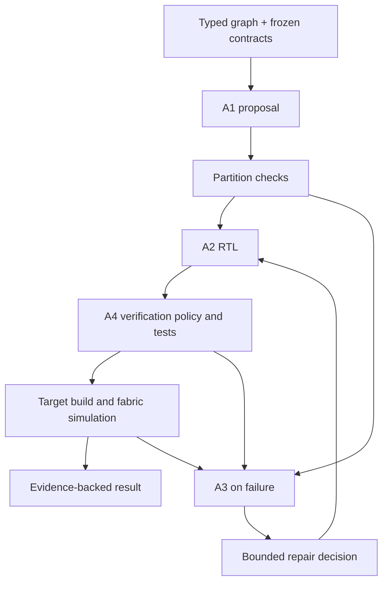

# A1–A4 agent architecture

Status: design proposal. The web application currently runs deterministic adapters. An LLM provider, agent state store and agent tool dispatcher are not implemented. This document specifies the next integration layer without presenting it as completed work.

## Shared contract

An agent proposes an action; application code authorizes it, validates its schema, executes an allowlisted operation and records evidence. Reuse the existing project access rules, immutable inputs, queue and artifact storage. Do not give the model unrestricted shell access, a physical-board password or permission to fabricate build records.

Each proposal should identify the graph/input hash, target profile revision, numerical contract, action, rationale and supporting artifacts. The controller must reject stale input/profile references. Returned results should include actual command evidence and explicit `passed`, `failed`, `unsupported` or `unknown` outcomes as appropriate.

## A1: mapping

Inputs: a typed graph, operator support matrix, target resources, memory limits, communication protocol and precision contract. Outputs: node-to-target assignments, partition boundaries, transfer layout, tiling decisions and estimates.

`validate_partition` is a proposed validation component, not a currently integrated agent tool. It must check graph coverage, legal operators/shapes, numerical compatibility, memory use, dependencies and interface consistency. Estimates require subsequent synthesis and routing validation. Reproducing a baseline is an initial milestone; it does not establish improved cost or performance.

## A2: RTL

Generate one supported eFPGA operator from a fixed contract covering ports, clock/reset, handshakes, shapes, packing and arithmetic semantics. Store every proposed revision rather than overwriting trusted source.

Use Icarus or another simulator to compare RTL output with an independent Python/NumPy oracle. Yosys performs synthesis and may compare hardware representations for equivalence; it does not directly prove a NumPy program equivalent to RTL. A passing operator test is followed by target synthesis, placement/routing, configuration generation and configured-fabric simulation.

## A3: diagnosis and repair

Classify source/elaboration failures, numerical mismatches, overflow/precision errors, protocol/backpressure issues, missing tools, resource exhaustion, routing/timing failures, configuration errors and simulation timeouts. Require supporting log locations or counterexamples. Include `unknown` and allow multiple contributing causes.

An injected-bug suite measures recognition of those fixtures, not coverage of arbitrary failures. Add held-out chain/tool failures and verify proposed fixes by reproducing the original failure and rerunning checks. Never permit changes to the oracle or success criteria as a repair shortcut.

## A4: verification

One role proposes additional tools; another proposes test cases addressing coverage gaps. Mandatory checks are selected by trusted policy and cannot be waived by either agent.

Useful cases include zero/boundary inputs, signed extremes, sparse/basis vectors, arithmetic limits, reset during activity, backpressure, dimensions not aligned to stream words, truncated configuration streams, missing completion markers and timeout handling. Oracle semantics must define scales, zero-points, signedness, accumulator widths, rounding and saturation.

## Controller and automation

Set retry/time/cost limits, retain all attempts and support cancellation. Separate read-only inspection, patch proposals, source mutation, compilation and board programming permissions. Hardware operations require compatible target identity, exclusive access and an authorized action. Run untrusted generated RTL in an appropriately isolated compiler environment before offering broad multi-user access.

## Known graph metadata gap

The inspected local TinyMobileNetV2 export has 51 nodes: 16 Conv2d, 16 BatchNorm2d, 11 ReLU6, three additions, one AdaptiveAvgPool2d, one flatten, one Linear, one input and one output.

The 27 shape-preserving module nodes are 16 BatchNorm2d and 11 ReLU6. They are not identities. Resolve module kinds using the captured model's module lookup; export kinds, attributes, input edges, shapes, dtypes and quantization metadata. The current upstream optimizer reports fusion opportunities but performs no graph rewrite. Any BatchNorm folding requires trained parameters/statistics and independent validation; ReLU6 clipping must respect quantization.

## Acceptance milestones

1. Export typed graph and explicit target/precision contracts.
2. A1 reproduces a baseline and validators reject illegal partitions.
3. A2 generates a supported operator that passes independent checks and the complete target simulation chain.
4. A3 diagnoses held-out failures and validates bounded repairs.
5. A4 improves defined coverage without changing expected results.
6. Controller runs the chain with reliable cancellation, provenance and permission enforcement.

Model-provider choice, source-data handling policy, inference costs and deployment isolation remain implementation decisions. No provider key is included in this repository.
